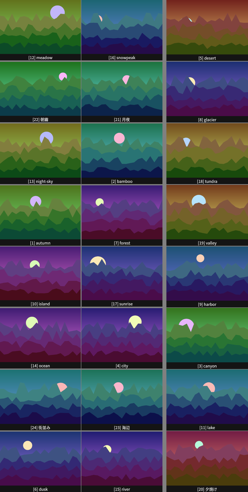

# pi-multiple-image-read

ローカルの複数の画像を、1回のツール呼び出しでモデルに見せる Pi 拡張です。
画像を1枚ずつ `read` に渡す代わりに、ファイル名のラベルを付けた「コンタクトシート」にまとめます。

```
read_images(paths: ["/tmp/shots/"])
  → 最大24枚ずつ、枚数を均等に割ったシート（ラベル付き）が画像として入る
  → 返答テキストが、ラベルの番号と元のパスの対応を全件示す
```



上の画像は、24枚の生成画像を `read_images` に渡した実際の出力です（[scripts/make-readme-sheet.ts](scripts/make-readme-sheet.ts) で再生成できます）。

## インストール

```bash
pi install git:github.com/kurowashi/pi-multiple-image-read
```

バージョンを固定する場合は `pi install git:github.com/kurowashi/pi-multiple-image-read@<tag|commit>` を使います。
ローカルの作業コピーを使う場合は `pi install /path/to/pi-multiple-image-read` を使います。

動作確認は Pi 1.0.3 と Node.js 22.19 以上で行っています。

## 使い方

モデルは複数の画像を見せるとき `read_images` を呼びます。手動で頼む場合は、次のように書きます。

```
/tmp/shots/ の画像を read_images で全部見て
```

## コマンド

コマンドは登録しません。モデル向けのツール `read_images` を登録します。

## 仕組み

### ツールの仕様

| 項目 | 内容 |
|---|---|
| ツール名 | `read_images` |
| 引数 | `paths`（文字列の配列、1件以上）。ファイル、ディレクトリ、glob（正規表現ではない）を混ぜて指定できる。全形式を拾うにはディレクトリか `dir/*` を使う（`*.png` は PNG だけになる）。`offset`（省略可、既定 0）は先頭から飛ばす枚数 |
| 対応形式 | PNG / JPEG / WebP / BMP / GIF（GIF は先頭フレーム）。TIFF は対象外 |
| 1回の上限 | 最大48枚。超える分は `offset` で次の呼び出しに回す。枚数は呼び出しごとに均等に割る（例: 49枚は 25 + 24）。返答に「Showing inputs 1-25 of 49. For the rest, call again with offset 25.」と出る |
| 1シートの枚数 | 最大24枚。枚数は均等に割る（例: 25枚は 13 + 12）。1枚だけのシートはできない |
| シートの大きさ | 長辺 2000 px 以下、画像トークン 4784 以下（Pi の画像上限に収まる）。枚数に応じて配置を変える |
| 番号 | 入力順の1始まりの通し番号。ディレクトリと glob の中は自然順（`img2` は `img10` より前）。シート上の配置は入力順と一致しません |
| ラベル | `[番号] ファイル名`（拡張子を除く）。同じ名前が複数あるときは拡張子付きの完全なファイル名 |

#### 返答テキスト

返答テキストには、全画像の番号とパスを番号順に載せます。ラベルが切れても、番号で元のファイルを特定できます。

```
13 image(s) on 2 sheet(s). Each label starts with its number in brackets, then the file name.
  1. /tmp/shots/a-very-long-name.png (label cut off)
  6. /tmp/shots/b.png
  13. /tmp/shots/other/shot_13.png (label shared with another file)
```

- 番号は入力順の通し番号です。ラベルの先頭に、角括弧で囲んで同じ番号を描きます。
- `(label cut off)`: ラベルが長すぎて、中央を `…` で省いた（先頭と末尾は残す）。
- `(label not drawn)`: 日本語の名前を描けなかった（後述）。番号は描かれています。
- `(label shared with another file)`: 同じ名前のファイルが別のディレクトリにあり、ラベルで区別できない。
- `skipped: <path> (<reason>)`: 読めなかった、または対応外の形式のファイル。残りの画像は返ります。

#### タイルの大きさに関する注意

1シートに24枚を並べるため、1枚のタイルは小さくなります。細部（小さな文字、指先、ファイルの欠陥など）は見えないことがあります。
タイルが 160 px 未満のときは、返答に注意が付きます。細部が必要なら、元のファイルを `read` で開いてください。

#### 日本語のラベル

ラベルには、システムにインストールされた日本語フォントを使います。候補の優先順は次のとおりです。

1. Noto Sans CJK JP
2. Noto Sans JP
3. Droid Sans Fallback
4. Hiragino Sans / Hiragino Kaku Gothic ProN（macOS）
5. Yu Gothic / Meiryo（Windows）

どれも見つからないと、日本語を含むラベルは描かれず、返答に `(label not drawn)` と注記が付きます。
画像の中ではファイル名が読めませんが、番号と返答テキストのパスで対応が分かります。
日本語のラベルを描くには、Noto Sans CJK JP などのフォントをインストールしてください。
なお、macOS と Windows の候補名は、この開発環境では確認していません。

### 失敗の例

失敗すると、原因を示すエラーがツール結果として返ります。セッションは続きます。

| 原因 | エラーの例 |
|---|---|
| 入力が空 | `no images given` |
| 全入力が画像を1枚も返さない | `no readable images; skipped: /tmp/none/*.png (no image matches (globs are not regular expressions; pass a directory))` |
| 明示指定の形式が対応外 | `unsupported image type: /tmp/scan.tiff` |
| offset が範囲外 | `offset 5 is past the last image (1 found)` |
| 復号できない | 返答に `skipped: /tmp/broken.png (cannot decode: ...)` と出て、残りは返る。全件失敗なら `no readable images: ...` |
| TIFF（ディレクトリ・glob 内） | 返答に `skipped: /tmp/x/scan.tif (unsupported image type)` |
| glob が一致しない・存在しない・画像のないディレクトリ | 返答に `skipped: /tmp/none/*.jpg (no image matches (globs are not regular expressions; pass a directory))` / `(not found)` / `(no images in directory)` と出て、残りは返る |

## 制限

- TIFF は対象外です。GIF は先頭フレームだけを使います。
- 1回の呼び出しで読むのは最大48枚です。残りは `offset` で続けて呼びます。
- タイルは小さくなるため、細部が見えないことがあります（[タイルの大きさに関する注意](#タイルの大きさに関する注意)）。
- 日本語のラベルは、フォントが無いと描かれません（[日本語のラベル](#日本語のラベル)）。

## ライセンス

[MIT](LICENSE)
